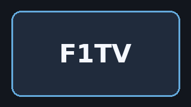
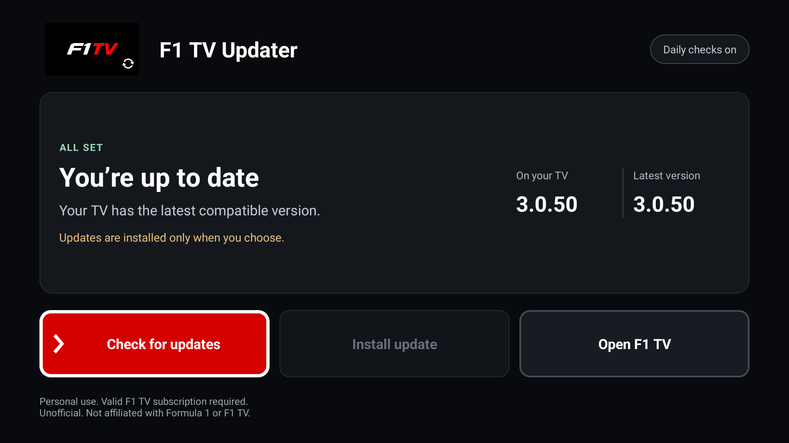
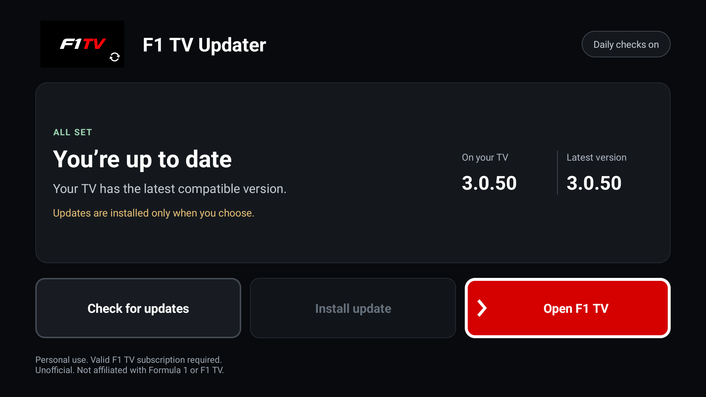
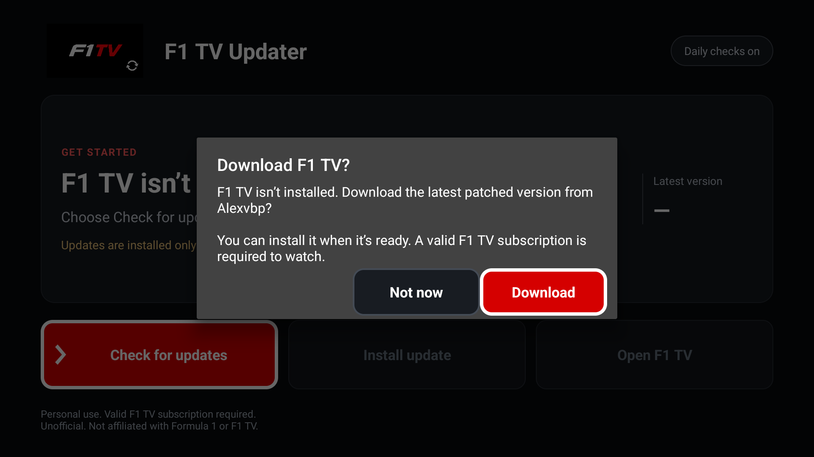

  
  <h1>F1TV Patch Updater</h1>
  
<strong>Updates on your TV. Leave the laptop closed.</strong>

  
A tiny, independent Android TV companion for Alexvbp’s F1 TV 4K patch.

  

    
    
    
    
  

  
<a href="https://github.com/Lzchyi/f1tv-patch-updater/releases/latest"><strong>↓ Download the latest APK</strong></a> &nbsp; · &nbsp; <a href="docs/install.md">Easy installation guide</a> &nbsp; · &nbsp; <a href="docs/faq.md">FAQ &amp; troubleshooting</a> &nbsp; · &nbsp; <a href="#screenshots">Screenshots</a> &nbsp; · &nbsp; <a href="CHANGELOG.md">What’s new</a>

## A small app for a simpler routine

No more moving every new update from your computer to your TV. The updater watches the latest stable release from [Alexvbp/f1tv-4k-patch](https://github.com/Alexvbp/f1tv-4k-patch), downloads it directly, and lets you choose when to install.

| Checks for you | Made for the remote | You stay in control |
| :--- | :--- | :--- |
| Checks versions first. Downloads only when needed, with daily and manual checks. | One screen, three large actions, and a bright red selection with a white outline. | Android asks before installing. A fresh install always needs your confirmation. |

## Get started

**You’ll need Android TV 8.0 or newer.** Version 0.3.0 can also set up F1 TV if it is not installed. Watching requires your own valid F1 TV subscription; 4K requires the appropriate Premium entitlement where available. [Subscription details](https://f1help.formula1.com/article/F1-TV-subscription-comparison)

**New to installing TV apps? Choose one route — no coding or building needed.**

| From your phone | With a USB stick | Over Wi-Fi with AI help |
| :--- | :--- | :--- |
| Send the APK with Send Files to TV or LocalSend. | Copy the APK to a stick and open it on your TV. | Let an assistant on your computer handle ADB. |
| [Phone transfer guide](docs/install.md#phone--tv) | [USB guide](docs/install.md#usb-stick) | [Wi-Fi guide + copyable AI prompt](docs/install.md#wi-fi-with-ai-help) |

1. Download **`f1tv-patch-updater-<version>.apk`** from the [latest release](https://github.com/Lzchyi/f1tv-patch-updater/releases/latest) and install it using your chosen guide. Select the APK under **Assets**, not **Source code**.
2. Open **F1TV Patch Updater**. If F1 TV is missing, choose **Download** in the setup prompt, or **Not now** to leave it. You can start setup later with **Check for updates**.
3. When the download is ready, choose **Install update**. Android may ask you to allow this updater to install apps once, then confirm installation. Already have F1 TV? The same three buttons handle future updates.

The updater installs the upstream bundle directly. **No AntiSplit-M or separate split installer is needed.** After setup, future patch checks and downloads happen on the TV; you choose when to install.

**Already using an older personal/prototype build?** This public edition installs separately. Future public releases use the same signing identity so the updater itself can be upgraded in place.

## Screenshots

Actual captures of the public edition running on Android TV.

| Ready at a glance | Easy to navigate |
| :---: | :---: |
|  |  |
| Your installed version and the latest release, together. | Clear focus, large controls, and no scrolling. |

The setup prompt was captured on a physical TV using an isolated test target. Version 0.3.0 keeps the same three-button screen, adds optional first-time setup, checks versions before downloading and cleans up installed bundles automatically.

## A few useful things to know

- **This is the updater, not the 4K patch.** The patch is Alexvbp’s work. This project doesn’t include F1 TV APKs, provide a subscription, or guarantee 4K playback on every device.
- **Some updates need a fresh install.** If an upstream signing key changes, Android cannot update the existing app normally. The updater explains this before removal. Continuing clears F1 TV’s sign-in and local settings; you’ll need to sign in again.
- **Daily checks are best-effort.** Android may delay background work while the TV sleeps. You can always select **Check for updates** yourself.
- **Updating this companion app is separate.** Download a newer updater APK from this repository’s Releases. Automatic checks inside the app are for the upstream F1 TV patch.

More detail: [How updates work](docs/how-it-works.md) · [Validation and limitations](docs/validation.md) · [Changelog](CHANGELOG.md)

## Credits & independence

**Independent hobby project intended for personal use with your own valid F1 TV subscription. No subscription or streaming content is provided.** Use remains subject to [F1 TV's terms](https://www.formula1.com/en/information/f1-tv-subscription-terms.384sQqjslhQ2Rhm1LdKgfD); this project does not authorise modifications or uses prohibited by those terms. This intended-use notice does not change the MIT licence for the updater's own code.

The 4K patch is created and maintained by **[Alexvbp](https://github.com/Alexvbp)** in **[f1tv-4k-patch](https://github.com/Alexvbp/f1tv-4k-patch)**. This updater simply makes that project’s releases easier to install on Android TV. Thanks to Alexvbp and the upstream contributors.

**Unofficial. Not affiliated with, sponsored by, or endorsed by Formula 1, F1 TV, or the upstream patch author.** Formula 1, F1 TV, and related names and marks belong to their respective owners. This notice does not grant rights to third-party branding or software.

The updater’s own code is available under the [MIT License](LICENSE). Third-party names, branding, and upstream software are not covered by that licence. The upstream project has its own terms; review them before use or redistribution.
